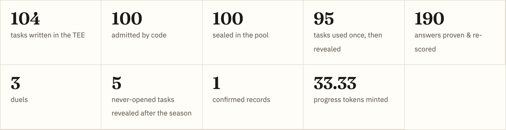
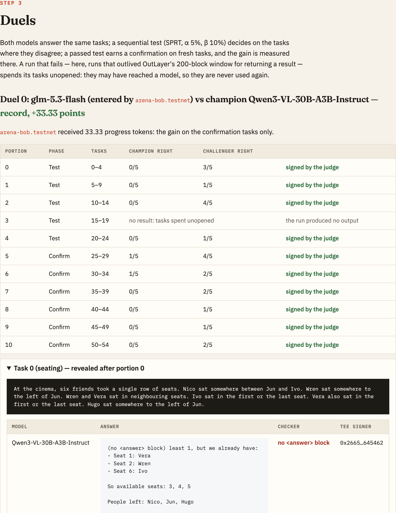
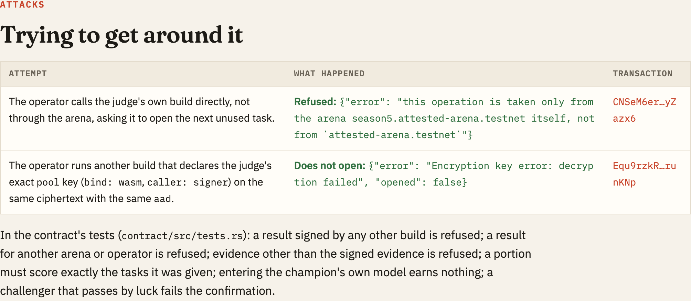
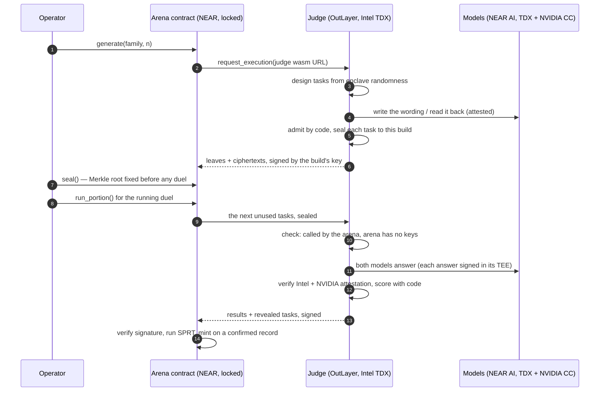

# Attested Arena

**A model benchmark whose test set nobody has ever seen — not the model developers, not the organiser, not us — and whose every score anyone can re-check. Sponsors fund it; proven improvements get paid.**

Built at NEAR HACKATHON (November 2026) · tracks: **Privacy & Private AI**, **AI Security & Defense**

> **[Open the report →](https://zavodil.github.io/attested-arena/)** — a full season that ran on NEAR testnet, every number with the evidence behind it ([`web/index.html`](web/index.html) in this repo).
>
> **Check it yourself in three minutes, with no account and no key:** `cargo run --release -p arena-verify -- --snapshot web/evidence/snapshot` → `39 checks passed, 0 broken.`

---

## Why

A community just pushed a 0.8B model from 17.4% to 53.4% in one week by editing its weights ([Delta League](https://deltaleague.ai)). That kind of open, cheap, fast model improvement only works if one question has a good answer: **how do you trust the results?**

The answer everybody agrees on is a private evaluation set that no one has seen, that is not on the internet, and that runs on a model without being revealed to its developer. Today that set always has an owner who has seen it:

- **Test sets leak.** Public benchmarks end up in training data. Even a private set leaks by design when it is run on a closed model: evaluating it means sending every question to the model's vendor.
- **The holder of a private set is trusted on their word.** They saw it, they can change it, and nobody outside can check. FrontierMath's problems were funded by a lab it ranks, which had access to most of them.
- **Leaderboards get fitted.** Every submission against a fixed hidden set returns a score; after enough of them, picking the best of many tries starts to look like progress. On a 500-task set the standard error is about 2 points — wider than many of the gaps a leaderboard is asked to rank.

**Attested Arena removes the one person who has seen the test.** The tasks are created inside a TEE, sealed to the exact build of the code that created them, and committed on NEAR before the first duel. Models answer them inside NEAR AI's confidential inference. Every task is used once and revealed with its result, so anyone can re-check every score. Sponsors put money behind a season; a model that proves it is better gets paid, automatically, by a contract that trusts only the judge's signature.

This is the neutral ground for **verifiable eval-as-a-service**: a company can fund a season on its own kind of problem and pay whoever improves a model at it — without anyone, including the company, being able to leak or tune the test.

## What we built

| | |
|---|---|
| **A judge that writes the exam in a TEE** | An [OutLayer](https://outlayer.ai) WebAssembly module in Intel TDX. Code designs each task from the enclave's randomness; a model in NEAR AI's confidential inference writes the wording; a second model reads it back; code decides admission. Tasks leave the enclave only as ciphertexts and hashes. |
| **Keys bound to one build** | The judge runs straight from its wasm URL, so OutLayer derives its keys from the build's sha256. Any other build — a later version of this very code too — cannot open the pool or sign as the judge. |
| **Duels decided by statistics, not by luck** | Champion and challenger answer the same tasks; a sequential test (SPRT) decides on their disagreements; a record must be confirmed on fresh tasks, and its gain is measured there. |
| **A season contract on NEAR** | Merkle commitment before any duel, every signed result (lost duels too), the evidence, a sponsors' pool and an NEP-141 progress token minted for confirmed gains. Locked: no key can change it. |
| **`arena-verify`** | Re-checks a whole season from NEAR state alone: the root, every signature, every revealed task against its leaf, every model answer against its TEE signature and Intel quote, every score with the same checker code, every duel and every token. |

## Try it

Rust (the toolchains are pinned in the repo) and an internet connection. No account, no key.

| Do | See |
|---|---|
| `cargo test` | 42 tests: task families and their checkers, admission, Merkle proofs, SPRT error rates, the judge's attestation checks |
| `(cd contract && cargo test)` | 16 tests, one claim each — a result signed by another build is refused, a copy of the champion earns nothing, money out is one rule per path |
| `cargo run --release -p arena-verify -- --snapshot web/evidence/snapshot` | the season re-checked from the snapshot saved with the report, Intel quotes verified against Intel's PCS: `39 checks passed, 0 broken.` |
| `cargo run --release -p arena-verify -- --arena season5.attested-arena.testnet` | the same, read live from NEAR testnet (the public RPC is rate-limited; pass `--rpc <url>` for your own) |
| `./judge/build.sh` | `sha256: c05fb8cc…` — the judge build the season pinned and OutLayer derived the judge's keys from |
| `./contract/build.sh` (Docker) | `NEAR code hash: 3ghXHYrw…` — the code NEAR reports for `season5.attested-arena.testnet` |
| open [`web/index.html`](web/index.html) | the season, step by step: tasks, answers, signers, verdicts, attempts to cheat, payouts |

## What happened on testnet

[`season5.attested-arena.testnet`](https://testnet.nearblocks.io/address/season5.attested-arena.testnet) ran end to end.



- **The exam.** The judge wrote 104 tasks inside the TEE; code admitted 100 and sealed each to the judge's build. The Merkle root was fixed on chain before the first duel.
- **A record.** `glm-5.3-flash` beat the base champion `Qwen3-VL-30B-A3B-Instruct`, passed the confirmation on fresh tasks, and gained **+33.33 points** there — minted as 33.33 progress tokens.
- **A rejection.** `Qwen3.6-35B-A3B-FP8` lost all 6 of its disagreements with the new champion.
- **A copy earns nothing.** The champion's own model, entered again, still answered 3 of 25 tasks differently from itself at temperature 0 (GPU batching is not bit-exact). The test called it noise. Nothing minted.
- **Cheating attempts failed.** The operator asking the judge directly for a sealed task was refused; another build declaring the judge's exact key could not decrypt the same task.
- **Money.** A sponsor's 5 NEAR went to the holder of the progress tokens; every entry deposit came back.
- **Every task is public now**, each provable into the root committed before the season.





## How it works



1. **The judge writes the exam inside a TEE.** Code designs each puzzle; a model writes its wording; a different model reads it back; code decides admission.
2. **The pool is sealed and committed.** Only ciphertexts and leaf hashes leave the enclave. The contract fixes the Merkle root before any duel.
3. **Entries.** Anyone enters a model with a deposit that always comes back.
4. **Duels.** Both models answer the same unused tasks in portions; each answer is signed inside the model's TEE and checked against its Intel and NVIDIA attestation; code scores; SPRT decides; a record is confirmed on fresh tasks.
5. **Reveal.** A portion's tasks are revealed with its result right away — they are never used again, so anyone can re-check a duel as soon as it happens.
6. **Money.** A confirmed gain mints progress tokens; after the season they redeem for `balance × pool / supply`.

## Why each design choice

| Choice | Why |
|---|---|
| **The judge runs from its wasm URL, not as a project** | A project's keys survive upgrades, so its owner could ship a version that dumps the pool. Keys derived from the build's sha256 die with the build. |
| **The arena is locked, and the judge checks it** | The contract decides which tasks a portion may open. With no key on its account, nobody can swap that code mid-season — and the judge refuses an arena that still has one. |
| **Code designs the task; a model only writes words** | Models cannot reliably write conditions consistent with their own answer (in our first test, 5 of 6 failed their own check). Code guarantees exactly one answer; the model's wording is checked by a second model. |
| **Admission borrowed from olympiad problem setting** | Polygon and the Kattis/ICPC format already solved "is this task sound": the author's solution must pass, known wrong answers must fail, damaged solutions must fail, a reader must understand the same task. |
| **Each task used once, revealed at once** | A fixed hidden set leaks through its scores. A one-use task leaks nothing about the next one, so it can be published immediately. |
| **Paired duels, SPRT, confirmation** | Generated pools drift in difficulty; only a paired comparison is immune. SPRT stops as soon as the evidence is enough. Confirmation on fresh tasks defeats picking the luckiest of many tries. |
| **Gain measured on confirmation tasks only** | The tasks that decided whether a challenger got a confirmation are biased in its favour; the ones after are not. |
| **The contract trusts only a signature** | No oracle and no relay: the judge's signed result arrives in the arena's own callback through OutLayer's yield/resume, and the contract checks the build's key. |
| **Reproducible builds** | The judge's sha256 is its identity and the contract's hash is what NEAR runs. Both rebuild to the same bytes from this repo. |

## Rules as code

**Families** ([`core/src/families/`](core/src/families/)):

- **`seating`** — who sits where in one row. Code plants an arrangement, adds true conditions until exactly one arrangement fits, then drops every condition the answer does not need. A model tells it as a story; a different model reads the story back; the two condition sets must be equal.
- **`lines`** — write a few lines under exact rules. A model writes a topic and a text; code reads the rules off that text (line count, acrostic, a line's word count, a common letter a line avoids, a word's count, the last word) and renders the statement from fixed templates.

**Admission** — a task enters the pool only if every rule holds, and each batch signs its rejection counts:

| Rule | Refuses a task when |
|---|---|
| validator | sizes, names, bounds or the statement are out of shape |
| witness | the author's own solution is refused by the checker |
| uniqueness | no answer, or more than the family allows, satisfies it (counted by brute force) |
| baselines | a known wrong answer is accepted — e.g. the order in which the story names the people |
| mutations | a damaged copy of the author's solution is accepted |
| independent reading | a second model, given only the statement, understands a different task |

## Why the pool stays sealed

| Mechanism | What it stops | Where |
|---|---|---|
| `pool` and `judge` keys derived from the build's sha256 (`bind: "wasm"`) | any other build — ours included — opening the pool or signing as the judge | [`judge/manifest.json`](judge/manifest.json), [`probe/`](probe/) |
| `pool` also bound to the transaction's signer | anyone but the operator running the judge on the pool | [`judge/manifest.json`](judge/manifest.json) |
| every opening call must come from a locked arena | the operator calling the judge directly; a contract swapped mid-season | [`judge/src/main.rs`](judge/src/main.rs) `guard`, [`judge/src/chain.rs`](judge/src/chain.rs) |
| a ciphertext opens only under `aad = attested-arena/task:{arena}:{leaf}` and must hash to its leaf | moving a task between seasons, swapping one task for another | [`judge/src/main.rs`](judge/src/main.rs) `open` |

## Money out stays simple

| Path | One rule |
|---|---|
| `redeem` | `balance × pool / supply`, both fixed at close; the tokens are burned |
| `reclaim` | only if no record was set: each sponsor takes back exactly what they put in |
| `refund_deposit` | each entry's deposit returns after the season, whatever its duel did |

## Weights, not just models

This season's duels run between NEAR AI's catalog models, because NEAR AI's confidential inference serves its own catalog only. The arena is written for Delta League's format (`delta.submission.v1`, a version named by the hash of its content). The one missing step: if NEAR AI serves an uploaded weight delta under its content hash, the response signature it already makes — `model_id:sha256(request):sha256(response)` — binds every answer to exact weights, and Delta League gets a private, verifiable, paid eval with no change to the arena or the judge.

## Honest gaps

| Gap | Today | What closes it |
|---|---|---|
| Uploaded weights | NEAR AI's confidential inference serves its catalog only | NEAR AI serving a model under its content hash (above) |
| Model identity | a model's quote attests its signing key and software stack, not a hash of its weights | weight hashes in NEAR AI's attestation |
| Hardware trust | Intel TDX and NVIDIA CC; physical attacks on a host are outside Intel's model (TEE.fail, 2025) | — an inherent limit of TEEs |
| Run time | OutLayer returns a result within 200 blocks; slow model answers can miss it (1 of 20 portions this season), and that portion's tasks are spent unopened | longer windows, or answers streamed across runs |
| Same model, different answers | at temperature 0 a model still disagrees with itself on some tasks (3 of 25 here) | none needed — the test treats it as noise, as it should |
| Families | two families; a sponsor's own domain needs its own family and checker | a family is ~300 lines of Rust with tests |

## Prior art

| System | What it does | What it leaves out |
|---|---|---|
| Kaggle, ARC Prize | private test split, offline runs | the organiser writes and sees the private set |
| HLE, FrontierMath, SEAL | private held-out sets | the same; FrontierMath's set was largely accessible to a lab it ranks |
| LiveBench | newest questions private, released later | evaluating a closed model sends the private questions to its vendor |
| LiveCodeBench, SWE-rebench, K Prize | tasks newer than a model's training cutoff | public tasks; freshness by date only |
| Reasoning Gym, GSM-Symbolic | procedural tasks with programmatic checkers | public generators, no secret |
| PeerBench (2025) | tests committed before a round, revealed after, used once | a human writes and sees the tests; no TEE |
| TRUCE (Microsoft, 2024), Attestable Audits (2025) | evaluation inside a TEE on a hidden set | the data owner writes and sees the set |
| Google DeepMind + OpenMined + MLCommons (2026) | double-blind evaluation on TDX + H100 | evaluators write the prompts; Google signs the attestation |

New here: **no human authors the tasks**, the commitment comes from attested code, the reveal proves both "not swapped" and "produced by this build", and rewards follow from the judge's signature with no oracle.

## What you still trust

- **The hardware**: Intel TDX and NVIDIA confidential GPUs, verified against Intel's and NVIDIA's own services.
- **OutLayer's keystore and workers** (both in TDX, measurements approved on NEAR), for deriving a build's keys only for that build and reporting a run's caller truthfully.
- **NEAR AI's deployment**, for which weights stand behind a model name.

Not the operator, not the organiser, and not this README.

## Built on NEAR and OutLayer

| What | How | Where |
|---|---|---|
| The judge in a TEE | OutLayer runs the wasm in Intel TDX, directly from its URL | [`judge/`](judge/) |
| Keys bound to the build | OutLayer's keystore derives `judge` (signing) and `pool` (encryption) from the build's sha256 | [`judge/manifest.json`](judge/manifest.json) |
| A secret for one build | the NEAR AI key is a secret row for this build's hash, readable only by the operator | [`scripts/season.py`](scripts/season.py) |
| NEAR RPC from the enclave | the judge checks that the arena has no full-access key | [`judge/src/chain.rs`](judge/src/chain.rs) |
| Yield/resume | the arena calls `request_execution`; the signed result returns in its own callback | [`contract/src/lib.rs`](contract/src/lib.rs) |
| Confidential models | NEAR AI Cloud; every answer's attestation checked in the enclave and again by `arena-verify` | [`judge/src/evidence.rs`](judge/src/evidence.rs) |
| The season on chain | commitment, duels, evidence, the sponsors' pool, the NEP-141 progress token | [`contract/`](contract/) |

## Repository

| Path | What |
|---|---|
| [`core/`](core/) | the rules as code: task families, checkers, admission, the participant request, Merkle tree, SPRT, signed payloads |
| [`judge/`](judge/) | the OutLayer module; `build.sh` builds it reproducibly |
| [`contract/`](contract/) | the season contract (near-sdk 5.9); `build.sh` builds it reproducibly in Docker |
| [`verify/`](verify/) | `arena-verify`; `calibrate`, a development tool for tuning families outside any TEE |
| [`probe/`](probe/) | an experiment: another build that declares the judge's key and tries to open a sealed task |
| [`scripts/`](scripts/) | `season.py`, `run_season.sh`, `experiments.py`, `report.py`, `shots.py`, `tx.py` |
| [`web/`](web/) | the report, its screenshots, and the evidence snapshot it was built from |

## Run a season yourself

```bash
./judge/build.sh && ./contract/build.sh
outlayer upload dist/arena-judge.wasm                       # FastFS URL; the sha256 is the judge's identity
outlayer secrets set '{"NEARAI_API_KEY":"…"}' --wasm-hash <sha256> --profile arena --access whitelist:<operator>
scripts/season.py deploy <season> <sha256>                  # pins the judge's key, deploys, locks the account
scripts/run_season.sh <season> <judge-sha256> <probe-sha256>  # pool, duels, experiments, close, reveal, payouts
scripts/report.py <season> --verify-output <file> && scripts/shots.py <season>
```

## Hackathon notes

- **Built in the window.** Everything in this repository was written from 2026-11-11 to 2026-11-14.
- **Our other NEAR HACKATHON project:** [Provable AI Compliance](https://github.com/zavodil/near-attested-ai) — every AI request a company makes checked against a compliance framework in a TEE, with proof. Independent of this one: different problem, different code. Attested Arena reuses one piece of it — its checks of NEAR AI's attestation (Intel quote, NVIDIA verdict, EIP-191 response signature), adapted in [`judge/src/`](judge/src/) (`intel.rs`, `nvidia.rs`, `eip191.rs`, `nearai.rs`, `http.rs`).
- **Pre-existing platform.** [OutLayer](https://outlayer.ai) (by the same author) and its SDK [`outlayer` 0.2.1](https://crates.io/crates/outlayer) existed before the hackathon; they are used as a platform, not changed.
- **Libraries.** near-sdk and near-contract-standards 5.9, serde, serde_json, sha2, hex, base64, k256, sha3, dcap-qvl (Intel quote verification), wasi 0.13, reqwest, ed25519-dalek; Playwright for the screenshots.
- **AI-written code.** The code, tests and texts were written with Claude Code (Anthropic), directed and reviewed by the author.

## License

MIT or Apache-2.0, at your option.
